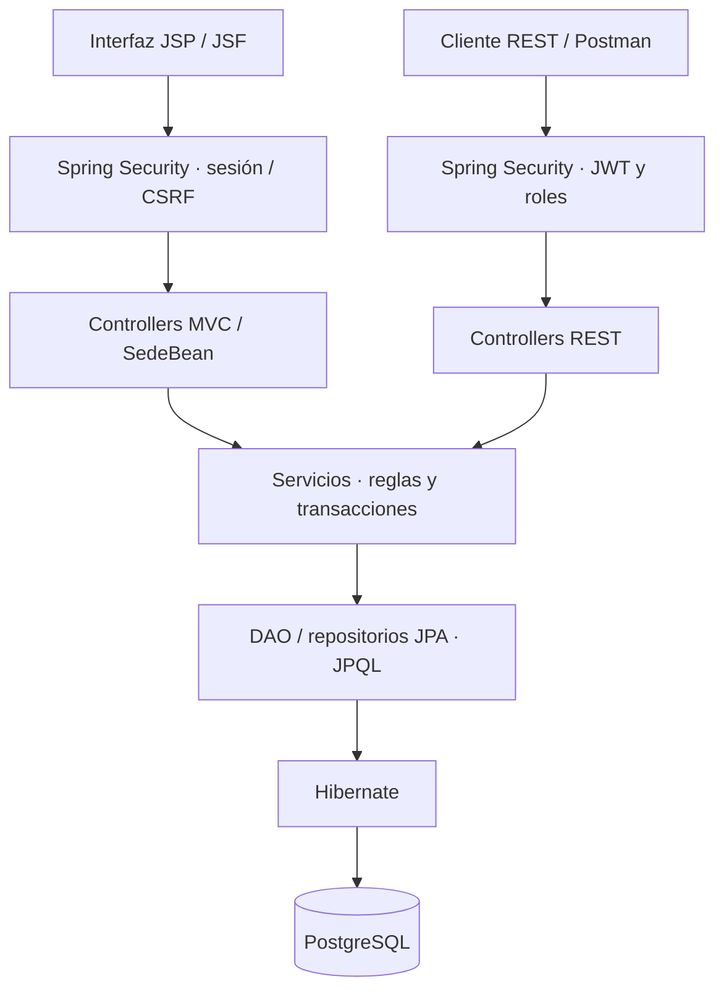
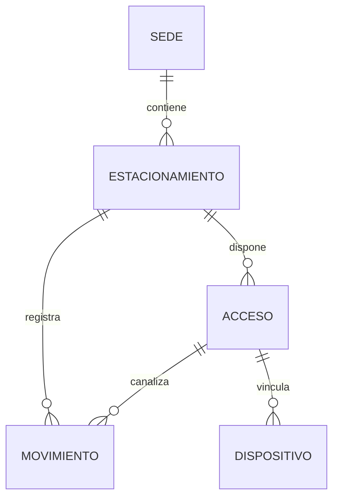

<div align="center">

# ParkUTP

### Gestión de estacionamientos · UTP Arequipa

**Proyecto Integrador — Desarrollo Web Integrado**<br>
**Avance 2 · Persistencia y seguridad**

</div>

<p align="center">
  
  
  
  
  
</p>

Desarrollamos **ParkUTP** para centralizar la administración de sedes y estacionamientos, registrar entradas y salidas y consultar disponibilidad e historial. En esta entrega integramos persistencia PostgreSQL con JPA/Hibernate, consultas JPQL, transacciones y autenticación JWT con permisos por rol.

Construimos la interfaz actual con JSP, JSF y Bootstrap. Trabajamos sobre el escenario de la UTP Arequipa; utilizamos datos de demostración que no representan capacidades ni registros institucionales reales.

| Nuestro objetivo | Nuestra entrega actual | Nuestro equipo |
|:---|:---|:---|
| Controlar el aforo y los movimientos por estacionamiento. | Backend persistente y seguro con interfaz web funcional. | **Sergio · Melissa · Ricardo** |

> [!NOTE]
> **Alcance de nuestra presentación:** esta documentación corresponde al APF2. Contemplamos Angular para el siguiente avance; reservas e integración física permanecen como propuestas futuras.

| Quiero… | Ir a… |
|:---|:---|
| Instalar y ejecutar el proyecto | [Instalación paso a paso](#3-instalación-paso-a-paso) |
| Conocer las pantallas y los roles | [Usuarios](#6-usuarios-y-seguridad) · [Guía de uso](#7-guía-de-uso) |
| Revisar arquitectura y API | [Arquitectura y datos](#8-arquitectura-y-datos) · [API REST](#9-api-rest) |
| Ejecutar pruebas y preparar la exposición | [Pruebas](#11-pruebas-automatizadas) · [Postman](#12-postman) · [Demostración](#14-demostración-del-apf2) |

---

<details>
<summary><strong>Índice completo · desplegar las 18 secciones</strong></summary>

1. [Funcionalidades](#1-funcionalidades)
2. [Tecnologías y requisitos](#2-tecnologías-y-requisitos)
3. [Instalación paso a paso](#3-instalación-paso-a-paso)
4. [Demo local independiente](#4-demo-local-independiente)
5. [Configuración](#5-configuración)
6. [Usuarios y seguridad](#6-usuarios-y-seguridad)
7. [Guía de uso](#7-guía-de-uso)
8. [Arquitectura y datos](#8-arquitectura-y-datos)
9. [API REST](#9-api-rest)
10. [Reglas y transacciones](#10-reglas-y-transacciones)
11. [Pruebas automatizadas](#11-pruebas-automatizadas)
12. [Postman](#12-postman)
13. [Compilación y ejecución](#13-compilación-y-ejecución)
14. [Demostración del APF2](#14-demostración-del-apf2)
15. [Solución de problemas](#15-solución-de-problemas)
16. [Trabajo en equipo](#16-trabajo-en-equipo)
17. [Cumplimiento y documentación](#17-cumplimiento-y-documentación)
18. [Límites y evolución](#18-límites-y-evolución)

</details>

---

## 1. Funcionalidades

Orientamos nuestra solución al personal que administra, opera o supervisa el estacionamiento. Implementamos las siguientes funcionalidades:

- Administración de sedes por API; registro y consulta mediante JSF.
- CRUD de estacionamientos mediante JSP y API REST.
- Creación automática de un acceso de entrada y otro de salida por zona.
- Gestión de accesos por API.
- Registro manual o simulación de movimientos, con placa opcional.
- Aforo, espacios disponibles, porcentaje de ocupación y luz virtual.
- Historial con filtros por fecha, placa parcial y tipo de movimiento.
- Actualización de la operación cada cinco segundos.
- Validación de sobreaforo, placas duplicadas y salidas sin entrada pendiente.
- Reintentos idempotentes mediante UUID.
- Login, cierre de sesión y roles ADMIN, OPERADOR y CONSULTA.
- Pruebas de negocio, persistencia, concurrencia, rollback y seguridad.

Delimitamos este avance al control operativo del estacionamiento. Dejamos reservas, cuentas de estudiantes, integración con la app UTP y dispositivos físicos para futuras etapas.

## 2. Tecnologías y requisitos

Seleccionamos las siguientes tecnologías para implementar nuestra arquitectura y los requisitos del avance:

| Componente | Tecnología |
|---|---|
| Lenguaje | Java 21 |
| Backend | Spring Boot 3.2.5 y Spring MVC |
| Persistencia | Spring Data JPA e Hibernate |
| Base de datos | PostgreSQL; cierre verificado con PostgreSQL 18 |
| Seguridad | Spring Security, BCrypt y JJWT 0.12.6 |
| Vistas | JSP, JSTL, EL y Jakarta Faces 4 con JoinFaces 5.2.5 |
| Interfaz | Bootstrap 5.3.3 mediante WebJars |
| Compilación | Maven Wrapper; distribución Maven 3.9.16 configurada |
| Pruebas | JUnit, MockMvc, PostgreSQL y node:test |
| Empaquetado | WAR ejecutable con Tomcat embebido |

Para ejecutar: Git, JDK 21 completo y PostgreSQL. Para verificar: Node.js para las pruebas JavaScript y Postman para la API.

No es necesario instalar Maven por separado. La primera compilación necesita acceso a Maven Central. Bootstrap se sirve desde el proyecto y no necesita un CDN durante el uso.

## 3. Instalación paso a paso

Documentamos el procedimiento para reproducir nuestra aplicación en una computadora con Windows.

| Etapa | Resultado esperado |
|:---|:---|
| 1. Preparar entorno | PowerShell, repositorio y JDK 21 disponibles. |
| 2. Configurar PostgreSQL | Bases de aplicación y pruebas separadas. |
| 3. Introducir credenciales | Conexión, cuentas demo y firma JWT configuradas. |
| 4. Iniciar | Login disponible en `http://localhost:8081/login`. |

### 3.1 Abrir PowerShell

La guía utiliza **Windows PowerShell**, salvo bloques SQL o CMD identificados. El prompt `PS C:\...>` indica PowerShell. Si aparece solo `C:\...>`, se está usando CMD.

Desde CMD se puede abrir PowerShell:

```cmd
powershell -NoProfile
```

No copiar el prompt junto con los comandos.

### 3.2 Clonar y entrar al proyecto

```powershell
cd "$env:USERPROFILE\Downloads"
git clone https://github.com/serchiove/parkutp-proyweb.git parkutp-avance2
cd .\parkutp-avance2\parkutp
```

`parkutp-avance2` es la raíz Git. Su subcarpeta `parkutp` contiene `pom.xml`, `mvnw.cmd` y los scripts. Ejecutar Maven e inicio desde esa subcarpeta. Si ya existe una copia, entrar en ella sin repetir el clon.

### 3.3 Configurar Java 21

Definir la ruta real del JDK, sin añadir `\bin`. Sustituir el ejemplo por la instalación disponible:

```powershell
$env:JAVA_HOME = 'C:\ruta\real\al\jdk-21'
& "$env:JAVA_HOME\bin\java.exe" -version
& "$env:JAVA_HOME\bin\javac.exe" -version
```

Ambos comandos deben mostrar versión 21. Si JAVA_HOME está ausente, `Iniciar.ps1` intenta detectar Adoptium 21 en `C:\Program Files\Eclipse Adoptium`.

Si la extensión Java de VS Code instaló un JDK en esta ubicación, se puede seleccionar tras comprobarlo:

```powershell
$jdkVsCode = "$env:APPDATA\Code\User\globalStorage\pleiades.java-extension-pack-jdk\java\21"
if (Test-Path "$jdkVsCode\bin\javac.exe") {
    $env:JAVA_HOME = $jdkVsCode
}
```

### 3.4 Crear las bases

Para esta modalidad se usa el servicio PostgreSQL instalado, normalmente en `localhost:5432`. En pgAdmin, conectarse con una cuenta autorizada y abrir Query Tool sobre `postgres`. Si la base no existe, ejecutar:

```sql
CREATE DATABASE parkutp;
```

Crear por separado la base exclusiva de pruebas:

```sql
CREATE DATABASE parkutp_test;
```

> [!WARNING]
> **Separar datos de aplicación y pruebas.** Conservamos los datos funcionales en `parkutp`. La suite borra tablas de `parkutp_test`; nunca debe apuntar a una base con datos de trabajo.

No crear tablas manualmente. Al iniciar, Spring ejecuta `schema.sql` y `schema-seguridad.sql`; Hibernate valida la compatibilidad. La cuenta necesita permisos para crear los objetos iniciales y operar sobre ellos. Los ejemplos usan `postgres`; se puede sustituir por una cuenta dedicada con permisos suficientes.

### 3.5 Introducir la contraseña de PostgreSQL

En la misma terminal:

```powershell
$env:DB_URL = 'jdbc:postgresql://localhost:5432/parkutp'
$env:DB_USER = 'postgres'
$claveDb = Read-Host 'Contraseña de PostgreSQL' -AsSecureString
$env:DB_PASSWORD = [System.Net.NetworkCredential]::new('', $claveDb).Password
Remove-Variable claveDb
```

La clave no se muestra al escribirla. Ajustar usuario y puerto a la instalación. Esta contraseña corresponde a PostgreSQL, no al login web.

### 3.6 Elegir la clave inicial de las cuentas web

Para una base nueva:

```powershell
$claveWeb = Read-Host 'Clave inicial para admin, operador y consulta' -AsSecureString
$env:DEMO_PASSWORD = [System.Net.NetworkCredential]::new('', $claveWeb).Password
Remove-Variable claveWeb
```

Solo se crean cuentas que no existan. **Las existentes conservan su contraseña:** cambiar DEMO_PASSWORD no la restablece. No hay contraseñas predeterminadas en el código.

### 3.7 Configurar la firma JWT

Generar una clave aleatoria para el entorno local:

```powershell
$bytesJwt = New-Object byte[] 64
$rngJwt = [System.Security.Cryptography.RandomNumberGenerator]::Create()
$rngJwt.GetBytes($bytesJwt)
$rngJwt.Dispose()
$env:JWT_SECRET = [Convert]::ToBase64String($bytesJwt)
Remove-Variable bytesJwt, rngJwt
```

Para conservar la firma entre sesiones, gestionar la clave fuera de Git e inyectar el mismo valor. Si cambia, los tokens anteriores dejan de servir. Sin JWT_SECRET, se genera una clave temporal y se advierte que los tokens no sobreviven al reinicio; el login sigue funcionando.

### 3.8 Iniciar la web

```powershell
.\scripts\Iniciar.ps1
```

El script verifica el JDK, compila mediante Maven `package` y arranca `target\parkutp-apf2.war`. La compilación incluye pruebas; si TEST_DB_URL está definida, también ejecuta integración contra esa base de pruebas.

Esperar que Tomcat indique inicio en 8081 y que la aplicación esté iniciada. Abrir:

- [Login](http://localhost:8081/login).
- [Panel](http://localhost:8081/estacionamientos).
- [Sedes JSF](http://localhost:8081/jsf/sedes.xhtml).

Sin sesión, el panel redirige al login. Mantener abierta la terminal. `Ctrl+C` detiene la aplicación.

### 3.9 Siguientes ejecuciones

En la misma terminal basta con ejecutar el script otra vez. Al cerrar esa terminal se pierden las variables del proceso: configurar nuevamente conexión y JAVA_HOME si corresponde. No recrear bases ni cuentas; si ya existen usuarios, puede omitirse DEMO_PASSWORD.

> [!IMPORTANT]
> El bloque Read-Host del paso 3.5 solicita la clave. Nuestro script de inicio utiliza las variables ya configuradas y no pregunta automáticamente por ellas. Si se abre una terminal nueva, se debe repetir esa configuración.

Las variables de la terminal no configuran automáticamente Run/Debug de VS Code. Iniciar desde la terminal configurada para seguir este procedimiento.

## 4. Demo local independiente

Incluimos una modalidad alternativa para reproducir la demostración con una instancia PostgreSQL independiente.

Necesita los ejecutables PostgreSQL instalados, pero crea una instancia distinta del servicio habitual. Con JAVA_HOME configurada y DEMO_PASSWORD definida para cuentas nuevas:

```powershell
.\scripts\Iniciar.ps1 -DemoLocal
```

Si no detecta PostgreSQL, ajustar la carpeta bin a la versión instalada:

```powershell
.\scripts\Iniciar.ps1 -DemoLocal -PgBin 'C:\Program Files\PostgreSQL\18\bin'
```

| Propiedad | Demo |
|---|---|
| Dirección / puerto | `127.0.0.1:55432` |
| Base / usuario | `parkutp` / `parkutp_local` |
| Datos | `.local-data`, dentro del proyecto Maven |
| Registro | `.local-postgres.log` |
| Autenticación PostgreSQL | Confianza local, sin contraseña |

El script configura la conexión a esa instancia; la web mantiene su autenticación BCrypt. Los datos en 5432 y 55432 son independientes, aunque ambas bases tengan el mismo nombre. El modo de confianza es para una demostración en esta computadora; no configura ni modifica el servicio habitual.

Después de detener la aplicación con Ctrl+C, detener la instancia local:

```powershell
.\scripts\Detener-PostgresLocal.ps1
```

Si se indicó una ruta especial, añadir `-PgBin` también al detenerla. No se borran los datos. Antes de eliminar la carpeta del proyecto, respaldar `.local-data` con PostgreSQL detenido o hacer un respaldo lógico de PostgreSQL.

## 5. Configuración

Externalizamos la configuración mediante variables de entorno para separar el código de las credenciales y los ajustes de cada computadora.

| Variable | Uso | Predeterminado o comportamiento |
|---|---|---|
| `JAVA_HOME` | JDK de scripts y Maven | Detección limitada de Adoptium 21 si está ausente |
| `DB_URL` | URL JDBC de aplicación | `jdbc:postgresql://localhost:5432/parkutp` en properties; script normal exige definirla |
| `DB_USER` | Cuenta PostgreSQL | `parkutp` en properties; script normal exige definirla |
| `DB_PASSWORD` | Clave PostgreSQL | Vacía; configurar si el servidor exige contraseña |
| `PORT` | Puerto HTTP | `8081` |
| `JWT_SECRET` | Firma HMAC | Temporal si falta; mínimo 32 bytes UTF-8 si se proporciona |
| `JWT_EXPIRACION_MINUTOS` | Duración JWT | `60` |
| `DEMO_PASSWORD` | Clave inicial de nuevas cuentas | Sin valor no crea cuentas |
| `CORS_ORIGENES` | Orígenes API separados por comas | `http://localhost:4200` |
| `TOMCAT_BASE_DIR` | Trabajo de Tomcat | `./.tomcat` |
| `TEST_DB_URL` | Base de integración | Debe apuntar a `parkutp_test` |
| `TEST_DB_USER` | Cuenta de pruebas | Configurar para suite completa |
| `TEST_DB_PASSWORD` | Clave de pruebas | Según autenticación del servidor |

El origen CORS preparado no implica un frontend Angular implementado. La API sigue exigiendo JWT.

No existe cargador automático de `.env`: crear ese archivo por sí solo no configura la aplicación. Los scripts SQL con `CREATE TABLE IF NOT EXISTS` no sustituyen migraciones futuras. `spring.jpa.hibernate.ddl-auto=validate` valida, pero no modifica tablas.

## 6. Usuarios y seguridad

Definimos tres roles para separar administración, operación y supervisión. Aplicamos sus permisos tanto en la interfaz como en el servidor.

| Usuario | Rol | Permisos |
|---|---|---|
| `admin` | ADMIN | Consultar, administrar sedes/zonas/accesos y registrar movimientos |
| `operador` | OPERADOR | Consultar y registrar entradas/salidas, sin administración |
| `consulta` | CONSULTA | Leer sedes, zonas, aforo e historial |

| Acción | ADMIN | OPERADOR | CONSULTA |
|:---|:---:|:---:|:---:|
| Ver sedes, zonas, disponibilidad e historial | Sí | Sí | Sí |
| Registrar entradas y salidas | Sí | Sí | No |
| Crear, editar o eliminar recursos administrables | Sí | No | No |

> [!TIP]
> Para demostrar la separación de permisos, iniciar sesión con cada rol y repetir una consulta y una operación de escritura.

Creamos las cuentas de demostración mediante DEMO_PASSWORD y almacenamos sus contraseñas como hashes BCrypt. Las cuentas nuevas comparten la clave inicial elegida y las existentes no se sobrescriben. No incluimos una pantalla de registro o administración de cuentas en este avance.

- **Web:** login por formulario, sesión de servidor y CSRF para escrituras/logout.
- **API:** JWT firmado mediante `Authorization: Bearer <token>`, sin autenticación por sesión de API.
- **Operación:** obtiene JWT en `GET /sesion/token`, protegido por sesión y con `Cache-Control: no-store`. Lo conserva solo en memoria JavaScript.
- **Permisos:** el servidor autoriza las rutas; el guardado JSF también exige ADMIN a nivel de método.
- **Estado de cuenta:** una cuenta desactivada pierde acceso; cambios de rol actualizan sesión y rechazan JWT con el rol anterior.

Una cookie web no autoriza por sí sola `/api/**`. Si vence el token y la sesión sigue activa, la pantalla solicita otro y reintenta una vez conservando el UUID.

Logout invalida la sesión web, pero no revoca un JWT emitido. Este depende de su expiración y de las comprobaciones de cuenta/rol; no existe lista de revocación.

Verificamos la aplicación en localhost. Para un despliegue externo debemos configurar HTTPS, secretos y cookies según el entorno. Mantenemos las credenciales fuera del código versionado; si una clave se expone, debemos rotarla aunque se elimine del archivo actual.

## 7. Guía de uso

Organizamos el flujo principal de nuestra aplicación en la siguiente secuencia:

| 1 · Configuración | 2 · Operación | 3 · Supervisión |
|:---|:---|:---|
| ADMIN registra una sede y crea sus zonas. | ADMIN u OPERADOR registra entradas y salidas. | Los tres roles consultan disponibilidad e historial. |

### Registrar sede

1. Como ADMIN, abrir **Sedes**.
2. Completar, por ejemplo, `DEMO-SEDE` y `Sede de demostración`.
3. Guardar y comprobar la tabla.

El código admite letras, números, guion y guion bajo. El nombre es único ignorando mayúsculas. JSF permite registrar/listar; editar y eliminar sedes se hace por API.

### Crear zona

1. Como ADMIN, abrir **Estacionamientos → Nuevo estacionamiento**.
2. Elegir sede y completar nombre, capacidad y estado.
3. Usar capacidad `2` para una demostración pequeña.
4. Guardar y comprobar la zona y sus accesos automáticos.

La capacidad va de 1 a 10 000. El nombre no se repite dentro de una sede, ignorando mayúsculas. Los ejemplos son ficticios.

### Registrar movimiento

1. Como ADMIN u OPERADOR, abrir **Ver operación**.
2. Elegir MANUAL o SIMULADOR.
3. Introducir placa o dejar el campo vacío.
4. Registrar entrada/salida y comprobar aforo, mensaje e historial.

Con placa se valida su entrada pendiente en esa zona. Una salida anónima solo consume una entrada pendiente sin placa, nunca un vehículo identificado por otra placa. Las placas se normalizan a mayúsculas.

En API, omitir placa o usar `null` para un cruce anónimo. Una placa presente debe tener de 3 a 12 letras, números o guiones. SIMULADOR representa un cruce lógico completo, sin conexión física.

### Consultar

La operación actualiza aforo e historial cada cinco segundos, sin WebSocket. Una desconexión se indica como aforo sin confirmar y restringe registros hasta recuperar el estado válido.

El historial muestra hasta 50 coincidencias recientes. Filtra antes del límite e interpreta la fecha en hora de Arequipa (`America/Lima`). CONSULTA puede leer, sin controles ni permiso de registro.

### Editar o eliminar

ADMIN puede editar zonas. No se reduce capacidad por debajo de ocupación. Una zona inactiva rechaza entradas y permite salidas pendientes.

No se elimina una zona con movimientos o dispositivos; puede desactivarse. Una sede con zonas tampoco se elimina. La API de accesos conserva su tipo y protege movimientos y dispositivos relacionados.

### Cambiar de cuenta

Usar **Cerrar sesión** antes de entrar con otro rol. Para comparar roles simultáneamente, usar sesiones de navegador separadas.

## 8. Arquitectura y datos



Organizamos nuestro backend por responsabilidades e inyectamos las dependencias por constructor. Utilizamos DTO para validar entradas, servicios para aplicar reglas y DAO/repositorios para gestionar persistencia. Conservamos el SQL inicial en scripts de esquema, separado de controllers, JSP y el bean JSF.

```text
parkutp-avance2/                       Raíz Git
├── README.md                         Documentación principal
└── parkutp/                           Proyecto Maven
    ├── pom.xml
    ├── mvnw / mvnw.cmd / .mvn/        Maven Wrapper
    ├── scripts/                      Inicio, parada local y pruebas
    ├── postman/                      Colecciones API
    ├── docs/                         Decisiones y verificación
    ├── evidencias/                   Evidencias históricas
    └── src/
        ├── main/
        │   ├── java/com/utp/parkutp/
        │   │   ├── controller/api/   API y errores HTTP
        │   │   ├── controller/web/   MVC y navegación
        │   │   ├── dao/              Adaptadores JPA
        │   │   ├── dto/              Entrada y validación
        │   │   ├── entity/           Entidades JPA
        │   │   ├── exception/        Excepciones de negocio
        │   │   ├── model/            Modelos y respuestas
        │   │   ├── repository/       CRUD y JPQL
        │   │   ├── security/         JWT, filtros y roles
        │   │   ├── service/          Negocio y transacciones
        │   │   └── view/             SedeBean JSF
        │   ├── resources/
        │   │   ├── application.properties
        │   │   ├── schema.sql / schema-seguridad.sql
        │   │   └── static/           CSS y JavaScript
        │   └── webapp/
        │       ├── sedes.xhtml       Vista JSF
        │       └── WEB-INF/views/    JSP y fragmentos
        └── test/java/                Pruebas Java
```

`target`, `.maven-cache` y `.tomcat` se generan localmente. `.local-data` y `.local-postgres.log` pertenecen a la demo independiente y no se versionan.

Empaquetamos la aplicación como WAR para renderizar JSP con Tomcat embebido. Integramos Jakarta Faces y Spring mediante JoinFaces. Implementamos SedeBean como bean administrado por Spring accesible desde EL, sin la anotación histórica `javax.faces.bean.ManagedBean`.

### Modelo de datos

| Tabla | Contenido | Relación |
|---|---|---|
| `sede` | Código y nombre | Tiene varios estacionamientos |
| `estacionamiento` | Nombre, capacidad y estado | Pertenece a una sede |
| `acceso` | Punto ENTRADA o SALIDA | Pertenece a un estacionamiento |
| `movimiento` | UUID, tipo, origen, placa y fecha | Zona y acceso compatibles |
| `dispositivo` | Código, estado y última comunicación | Asociado a un acceso; preparado para futuro uso |
| `usuario` | Cuenta, hash, rol y estado | Autenticación independiente de sedes |



La tabla USUARIO administra autenticación y permisos de forma independiente; no representa una relación de autoría de movimientos.

Existe como máximo un acceso por tipo y estacionamiento. El UUID del evento es único. Una clave foránea compuesta exige que acceso, zona y tipo coincidan en un movimiento.

Delegamos en PostgreSQL la generación de `registrado_en` como TIMESTAMPTZ y calculamos el aforo con entradas menos salidas, sin mantener un contador duplicado. Nuestro modelo actual no incluye vehículo, estadía o reserva. Guardamos el origen del movimiento, pero no su usuario autor. Preparamos Dispositivo mediante esquema y entidad; su operación física y autenticación IoT quedan pendientes.

## 9. API REST

Exponemos nuestros recursos mediante una API REST para integrar clientes autenticados y comprobar el contrato HTTP con Postman.

URL base: `http://localhost:8081`. Usar `Content-Type: application/json` para JSON. Salvo login y solicitudes OPTIONS CORS permitidas, la API exige JWT.

### Autenticación

| Método | Ruta | Acceso | Éxito |
|---|---|---|---|
| POST | `/api/auth/login` | Público, con credenciales válidas | 200 |
| GET | `/api/auth/yo` | JWT válido | 200 |

Sustituir la clave de ejemplo por la configurada localmente:

```json
{"username":"admin","password":"CONTRASENA_WEB_CONFIGURADA"}
```

La respuesta contiene `token`, `tipo`, `expiraEnSegundos`, `usuario` y `rol`. Para solicitudes protegidas:

```http
Authorization: Bearer <token>
```

<details>
<summary><strong>Contrato HTTP · ver la matriz completa de recursos</strong></summary>

### Recursos

**Lectura:** los tres roles. **Operación:** ADMIN y OPERADOR. **Administración:** solo ADMIN.

| Método | Ruta | Permiso | Éxito |
|---|---|---|---|
| GET | `/api/sedes` | Lectura | 200 |
| GET | `/api/sedes/{id}` | Lectura | 200 |
| POST | `/api/sedes` | Administración | 201 |
| PUT | `/api/sedes/{id}` | Administración | 200 |
| DELETE | `/api/sedes/{id}` | Administración | 204 |
| GET | `/api/estacionamientos` | Lectura | 200 |
| GET | `/api/estacionamientos/{id}` | Lectura | 200 |
| POST | `/api/estacionamientos` | Administración | 201 |
| PUT | `/api/estacionamientos/{id}` | Administración | 200 |
| DELETE | `/api/estacionamientos/{id}` | Administración | 204 |
| GET | `/api/estacionamientos/{id}/accesos` | Lectura | 200 |
| GET | `/api/estacionamientos/{id}/accesos/{accesoId}` | Lectura | 200 |
| POST | `/api/estacionamientos/{id}/accesos` | Administración | 201 |
| PUT | `/api/estacionamientos/{id}/accesos/{accesoId}` | Administración | 200 |
| DELETE | `/api/estacionamientos/{id}/accesos/{accesoId}` | Administración | 204 |
| GET | `/api/estacionamientos/{id}/movimientos` | Lectura | 200 |
| POST | `/api/estacionamientos/{id}/movimientos` | Operación | 200 |

Registrar movimiento devuelve **200**, también al reenviar un evento idéntico. No esperar 201. Los dos accesos se crean con la zona; otro del mismo tipo genera conflicto.

</details>

### Ejemplos de cuerpos

Crear sede:

```json
{"id":"DEMO-SEDE","nombre":"Sede de demostración"}
```

Crear zona:

```json
{"sedeId":"DEMO-SEDE","nombre":"Zona de demostración","capacidad":2,"activo":true}
```

Registrar entrada:

```json
{
  "eventoId":"581230cc-d8b9-493a-b600-a2a8804f9b9c",
  "tipo":"ENTRADA",
  "origen":"MANUAL",
  "placa":"ABC-123"
}
```

Generar UUID nuevo por cruce; mantenerlo y conservar los datos al reintentar. En PowerShell: `[guid]::NewGuid().ToString()`. En Postman: `{{$guid}}`, guardando el valor si se reenviará. Una salida usa SALIDA y un UUID nuevo. Para cruce anónimo, `"placa": null`.

Actualizar nombre de un acceso conservando su tipo:

```json
{"nombre":"Ingreso principal","tipo":"ENTRADA"}
```

### Filtros

```http
GET /api/estacionamientos/1/movimientos?fecha=2026-10-12&placa=ABC&tipo=ENTRADA
```

Ajustar ID y filtros a datos existentes. `fecha` usa `yyyy-MM-dd`; placa acepta coincidencia parcial; tipo admite ENTRADA o SALIDA. Son opcionales y combinables.

### Errores

| HTTP | Significado habitual |
|---|---|
| 400 | Datos inválidos, JSON/UUID/fecha incorrectos o filtros no admitidos |
| 401 | Credenciales incorrectas, JWT ausente, inválido o vencido |
| 403 | Rol insuficiente; en web también CSRF ausente o vencido |
| 404 | Recurso inexistente o acceso ajeno a la zona indicada |
| 409 | Duplicado, aforo completo, salida sin entrada o historial/relaciones protegidos |

Los errores de negocio incluyen `mensaje`; Bean Validation añade `errores`. Ejemplo orientativo:

```json
{"mensaje":"Revisa los datos enviados","errores":["capacidad: ..."]}
```

## 10. Reglas y transacciones

Implementamos controles de integridad para que cada movimiento confirmado produzca un aforo coherente.

### Aforo y placas

- Zona llena rechaza entradas nuevas; zona vacía no admite salidas nuevas.
- Zona inactiva permite salidas pendientes, pero no ingresos nuevos.
- Una placa no entra dos veces seguidas ni sale sin entrada pendiente local.
- Salida anónima consume únicamente entrada pendiente sin placa.
- La presencia de placa se comprueba por estacionamiento, no globalmente.

### Idempotencia y concurrencia

Antes de validar un evento nuevo se busca su UUID. Si ya existe y conserva zona, tipo, origen y placa, se devuelve el original. Reutilizarlo con otros datos produce 409.

El registro bloquea la fila del estacionamiento con bloqueo pesimista dentro de una transacción. Dos entradas simultáneas no ocupan ambas el último espacio. La validación de placa se realiza bajo el mismo bloqueo.

El navegador puede conservar en localStorage un movimiento pendiente, separado por usuario y zona, para reenviar el mismo UUID. El JWT no se guarda allí.

### Atomicidad y rollback

1. **Alta de zona:** guarda estacionamiento y dos accesos. Si falla el segundo acceso, se revierten zona y primero.
2. **Registro:** valida y persiste bajo bloqueo. Si falla la inserción, no queda movimiento parcial y el aforo refleja los registros confirmados.

Comprobamos el rollback mediante pruebas con fallos controlados. Utilizamos JPQL para calcular el aforo y aplicar los filtros del historial antes del límite de 50 registros.

## 11. Pruebas automatizadas

Las capturas de la verificación están organizadas en:

- [Seguridad](parkutp/evidencias/seguridad/): login, petición autorizada y respuestas 401/403.
- [Persistencia](parkutp/evidencias/persistencia/): datos antes y después del reinicio.
- [Pruebas](parkutp/evidencias/pruebas/): Java, JavaScript y rollback.
- [Demostración](parkutp/evidencias/demo/): CRUD, aforo, movimientos, roles y filtro del historial.

> [!WARNING]
> La suite borra tablas de integración. TEST_DB_URL debe apuntar exclusivamente a `parkutp_test`. Tanto nuestro script como las pruebas verifican ese nombre.

### Java

Desde el proyecto Maven, con JAVA_HOME definida y base de pruebas creada:

```powershell
$env:TEST_DB_URL = 'jdbc:postgresql://localhost:5432/parkutp_test'
$env:TEST_DB_USER = 'postgres'
$claveTest = Read-Host 'Contraseña PostgreSQL para las pruebas' -AsSecureString
$env:TEST_DB_PASSWORD = [System.Net.NetworkCredential]::new('', $claveTest).Password
Remove-Variable claveTest
.\scripts\Probar.ps1
```

Para reutilizar la clave ya configurada: `$env:TEST_DB_PASSWORD = $env:DB_PASSWORD`. Compartir servidor/usuario no implica compartir base: usar siempre `parkutp_test`.

Esperar BUILD SUCCESS. Los resultados están en `target\surefire-reports`. Maven sin TEST_DB_URL omite integración; esa ejecución parcial no verifica todo el backend.

### JavaScript

Con Node.js disponible:

```powershell
node --test .\scripts\operacion.test.cjs
```

No necesita `npm install`. Cubre aforo, filtros, respuestas fuera de orden, desconexión, mensajes, JWT/renovación, lectura sin registro y sesión vencida.

### Resultados de nuestra verificación

| Verificación | Resultado registrado |
|:---|:---:|
| Suite Java | **72 aprobadas** |
| Suite JavaScript | **10 aprobadas** |
| Solicitudes HTTP de las colecciones | **32 verificadas** |
| Aserciones de las colecciones | **38 aprobadas** |

Verificamos CRUD, validaciones, JPQL, idempotencia, placas, concurrencia, rollback, roles, tokens inválidos/vencidos, cuentas desactivadas, cambios de rol, CSRF, login y logout.

> [!NOTE]
> Estos resultados corresponden a la verificación documentada del cierre del APF2. Las condiciones de ejecución están en [Verificación APF2](parkutp/docs/Verificacion-APF2.md); al repetir la suite, se deben conservar los nuevos resultados como evidencia.

## 12. Postman

Mantener el servidor iniciado e importar desde `postman/`:

| Colección | Propósito |
|---|---|
| `APF2-ParkUTP.postman_collection.json` | Login ADMIN, CRUD, movimientos, errores, aforo e idempotencia |
| `Seguridad-ParkUTP.postman_collection.json` | Login de tres roles, lectura autorizada, 401 y 403 |
| `Operacion-ParkUTP.postman_collection.json` | Login, aforo, historial, filtros y parámetros inválidos |
| `APF1-ParkUTP.postman_collection.json` | Antecedente histórico; no es la colección vigente del APF2 |

1. Definir `baseUrl`, normalmente `http://localhost:8081`.
2. Completar `demoPassword` localmente con la clave web real.
3. Ejecutar login primero; los scripts guardan tokens para las siguientes solicitudes.
4. En seguridad/operación, ajustar `estacionamientoId`. En operación, elegir fecha y placa con coincidencias reales para demostrar filtros.
5. Ejecutar APF2 en orden: crea datos de demostración y verifica que una zona con historial no se elimine.
6. Revisar resultados y guardar capturas.

Seguridad guarda tokens por rol y no modifica datos. Si las cuentas tienen claves diferentes, ajustar cada login. No exportar claves ni tokens de la sesión.

Para verificar nuestras tres colecciones ejecutamos **32 solicitudes y 38 aserciones** mediante un ejecutor temporal HTTP. Esa comprobación no se realizó en Postman ni Newman. Para la presentación, debemos ejecutar las colecciones en Postman y conservar sus capturas; las evidencias APF1 corresponden a la entrega anterior.

## 13. Compilación y ejecución

Incluimos `Iniciar.ps1` como flujo de arranque. También podemos compilar y ejecutar por separado, con JAVA_HOME y las variables definidas:

```powershell
$env:PATH = "$env:JAVA_HOME\bin;$env:PATH"
.\mvnw.cmd '-Dmaven.repo.local=.maven-cache' package
if ($LASTEXITCODE -ne 0) { throw 'No ejecutar el WAR: la compilación falló.' }
& "$env:JAVA_HOME\bin\java.exe" -jar .\target\parkutp-apf2.war
```

`package` ejecuta pruebas y genera WAR. No versionar `target`. Para otro puerto:

```powershell
$env:PORT = '8082'
.\scripts\Iniciar.ps1
```

Abrir entonces `http://localhost:8082/login` y cambiar baseUrl. No iniciar dos procesos en el mismo puerto. WAR es la modalidad verificada para las JSP.

## 14. Demostración del APF2

En nuestra presentación recorreremos el flujo completo y mostraremos las evidencias de persistencia, seguridad y transacciones.

### Preparar

- Verificar Java, PostgreSQL y bases separadas.
- Compilar antes para descargar dependencias y comprobar variables en la terminal del servidor.
- Preparar cuentas, colecciones y zona de prueba de capacidad 2.
- Ejecutar pruebas y reunir evidencias sin mostrar claves.

### Secuencia

1. Explicar problema y alcance.
2. Como ADMIN, registrar sede y crear zona.
3. Mostrar zona y dos accesos persistidos en PostgreSQL.
4. Como OPERADOR, registrar entrada/salida y ver aforo/historial.
5. Demostrar rechazo de negocio, por ejemplo entrada duplicada.
6. Como CONSULTA, demostrar lectura.
7. En Postman, login y respuestas 200, 401 y 403.
8. Explicar JPQL y pruebas de rollback/concurrencia.
9. Reiniciar la aplicación y comprobar persistencia.
10. Mostrar pruebas aprobadas y diferenciar ideas futuras.

Incluir capturas de CRUD, roles, API, persistencia y pruebas en el informe. Suite en `parkutp_test`; demostración funcional en `parkutp`.

## 15. Solución de problemas

<details>
<summary><strong>Diagnóstico rápido · desplegar errores frecuentes y soluciones</strong></summary>

| Síntoma | Solución |
|---|---|
| `$env:...` da error de sintaxis | Se usa CMD. Abrir PowerShell y repetir configuración. |
| Política bloquea el script | `Set-ExecutionPolicy -Scope Process Bypass` afecta solo esa terminal; ejecutar de nuevo. |
| «Configura DB_URL, DB_USER y DB_PASSWORD» | Repetir paso 3.5 en la terminal del script, o elegir DemoLocal. |
| SCRAM sin contraseña | DB_PASSWORD vacía. Introducirla mediante Read-Host. |
| Autenticación PostgreSQL falla | Revisar credenciales de PostgreSQL, distintas del login web. |
| Conexión rechazada/base inexistente | Revisar servicio, puerto y base; distinguir 5432/55432. |
| JAVA_HOME inválida | Definir JDK completo con javac y comprobar versión 21. |
| Error de compilación release 21 | Revisar Java de Maven con `.\mvnw.cmd -version`. |
| Puerto ocupado | Detener instancia anterior o cambiar PORT. |
| Login falla tras cambiar DEMO_PASSWORD | La cuenta existente conserva su clave anterior. No hay restablecimiento automático. |
| Advertencia DEMO_PASSWORD ausente | Normal con cuentas existentes; en base nueva configurarla y reiniciar. |
| JWT_SECRET temporal | Configurar clave estable si se desea validez entre reinicios. |
| API 401 | Hacer login y revisar Bearer, expiración, firma y estado/rol de cuenta. |
| API 403 | Usar una cuenta con permiso para esa acción. |
| Formulario web 403 | Reabrir con sesión activa; comprobar rol y CSRF. |
| Eliminación rechazada | Relaciones/historial protegidos; desactivar si corresponde. |
| Muchos errores de contexto en tests | Revisar primer «Caused by», conexión y TEST_DB_URL; el resumen no es la causa. |
| Suite fallida | Revisar `target\surefire-reports`; no omitir pruebas para ocultar el fallo. |
| Visor Git no vuelve al prompt | Pulsar `q`; después introducir el siguiente comando. |

Ante fallo de arranque, identificar la primera excepción. No borrar tablas o datos para intentar solucionar una conexión.

</details>

## 16. Trabajo en equipo

Nuestro equipo está conformado por **Sergio, Melissa y Ricardo**. Desarrollamos los avances sobre el mismo repositorio y problema, y documentamos las decisiones técnicas y las evidencias de cada entrega.

| Integrantes | Proyecto | Entrega |
|:---|:---|:---|
| Sergio · Melissa · Ricardo | ParkUTP — Desarrollo Web Integrado | Avance 2: persistencia y seguridad |

Desde la raíz Git, con trabajo local guardado:

```powershell
git switch main
git pull --ff-only origin main
git switch -c nombre-descriptivo-de-la-tarea
```

Editar y verificar antes de preparar los archivos. Ejemplo para esta documentación, utilizando el nombre de rama elegido:

```powershell
git add README.md
git --no-pager diff --cached --stat
git commit -m "Documenta instalación, uso y verificación completa del APF2"
git push -u origin nombre-descriptivo-de-la-tarea
```

Crear PR hacia main, revisar y fusionar cuando esté listo. Tras actualizar main, eliminar una rama local integrada con `git branch -d nombre-de-rama`. Coordinar antes de eliminar ramas ajenas y evitar borrados forzados sin revisar.

No subir claves, tokens, datos locales o directorios generados. Git clone descarga código, no datos PostgreSQL: crear una base o restaurar respaldo separado.

## 17. Cumplimiento y documentación

Relacionamos los requisitos del checklist con lo que implementamos para este avance:

| Checklist APF2 | Implementación |
|---|---|
| Base relacional y JPA/Hibernate | PostgreSQL y entidades JPA |
| CRUD persistente | Sedes, estacionamientos y accesos |
| JPQL útil | Historial filtrado y aforo |
| Transacción justificada | Zona/accesos y registro de movimiento |
| Roles diferenciados | ADMIN, OPERADOR, CONSULTA |
| JWT y rutas protegidas | Login, generación, filtros y autorización |
| Tests actualizados | Negocio, persistencia, concurrencia, rollback y seguridad |
| Postman actualizado | APF2, seguridad y operación autenticadas |

Documentación adicional:

- [Inicio original](parkutp/EMPIEZA-AQUI.md): ante diferencias, seguir esta guía actualizada.
- [Modelo y arquitectura](parkutp/docs/Modelo-y-arquitectura.md).
- [Historial y JPQL](parkutp/docs/JPQL-historial.md).
- [Persistencia JPA — Melissa](parkutp/docs/Persistencia-JPA-Melissa.md).
- [Registro de movimientos](parkutp/docs/Registro-movimientos-JPA.md).
- [Operación y aforo](parkutp/docs/Operacion-y-aforo.md).
- [Control por placa](parkutp/docs/Control-por-placa.md).
- [Seguridad APF2](parkutp/docs/Seguridad-APF2.md).
- [Verificación APF2](parkutp/docs/Verificacion-APF2.md).
- [Guion previo](parkutp/docs/Guion-demo.md): complementar con login y roles actuales.

## 18. Límites y evolución

En el APF2 delimitamos nuestra solución al control del estacionamiento por personal autorizado. Para el APF3 contemplamos Angular integrado con la misma API.

> [!IMPORTANT]
> Distinguimos las funcionalidades demostrables de las ideas futuras. Las propuestas siguientes no forman parte de nuestra implementación actual.

Como posibles mejoras planteamos:

- Reservas y cuenta de estudiante/conductor.
- Vehículos y estadías individuales.
- Espacios accesibles e integración con la app UTP.
- Sensores, barreras y luces físicas con autenticación de dispositivos.
- Auditoría del autor por movimiento, incidencias y reconciliación del aforo.
- Eventos físicos fuera de orden y desconexiones.
- Administración de cuentas, recuperación de claves y revocación explícita de JWT.

En nuestra versión actual registramos placas manualmente y representamos la disponibilidad con una luz virtual; SIMULADOR identifica pruebas. Para integrar dispositivos físicos deberemos registrar y reconciliar incidencias que hoy rechazamos mediante reglas de negocio.
