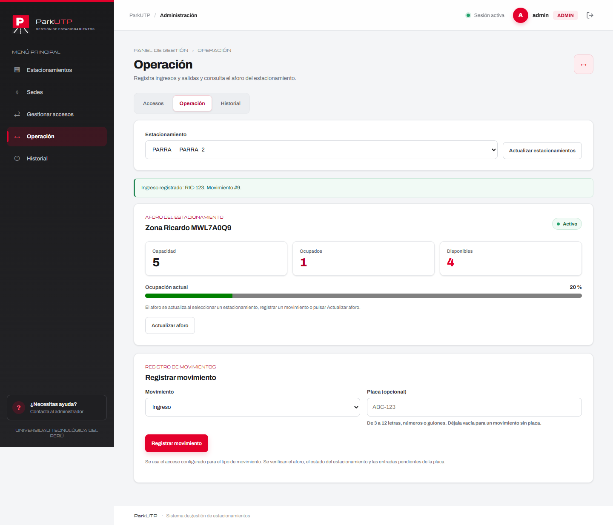
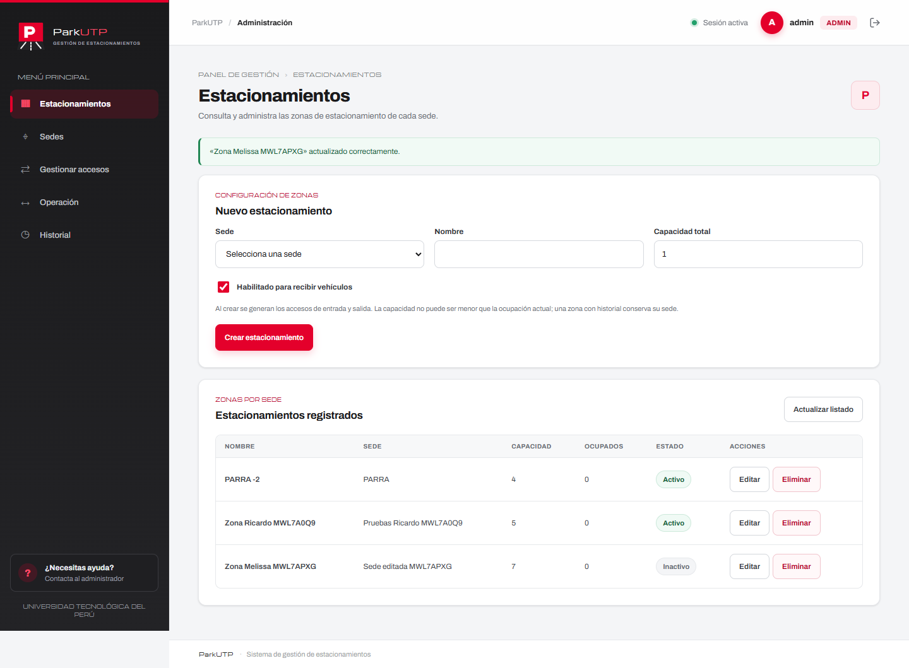
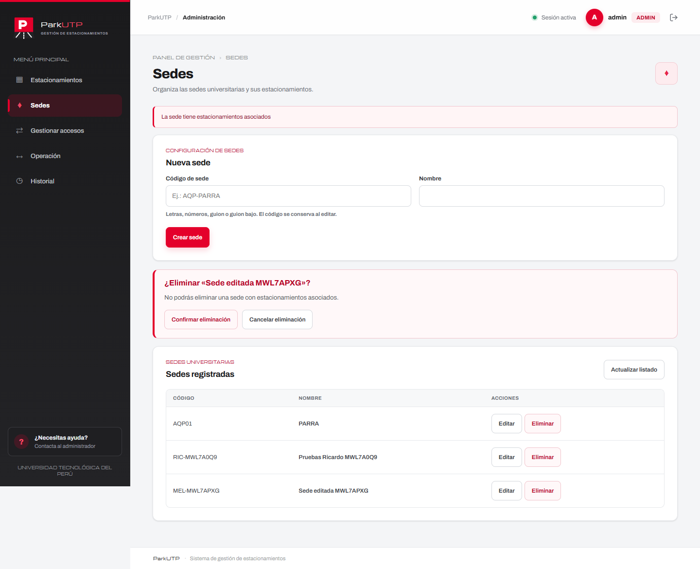
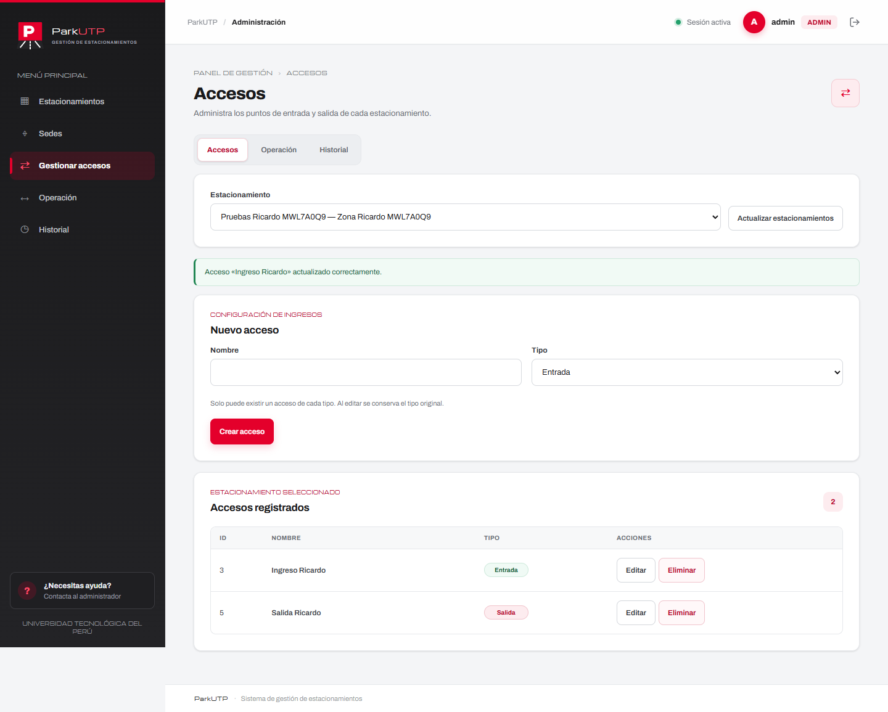
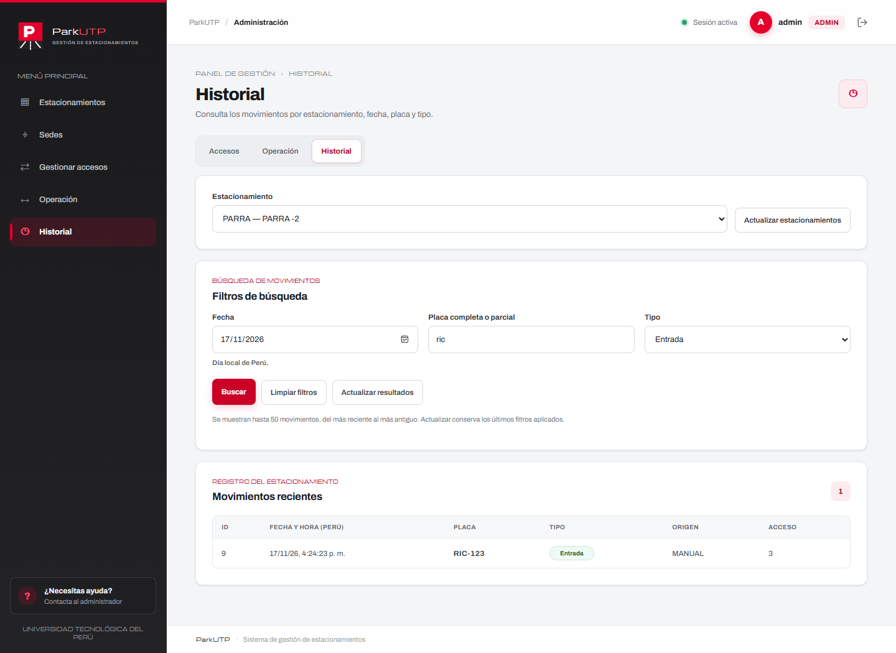
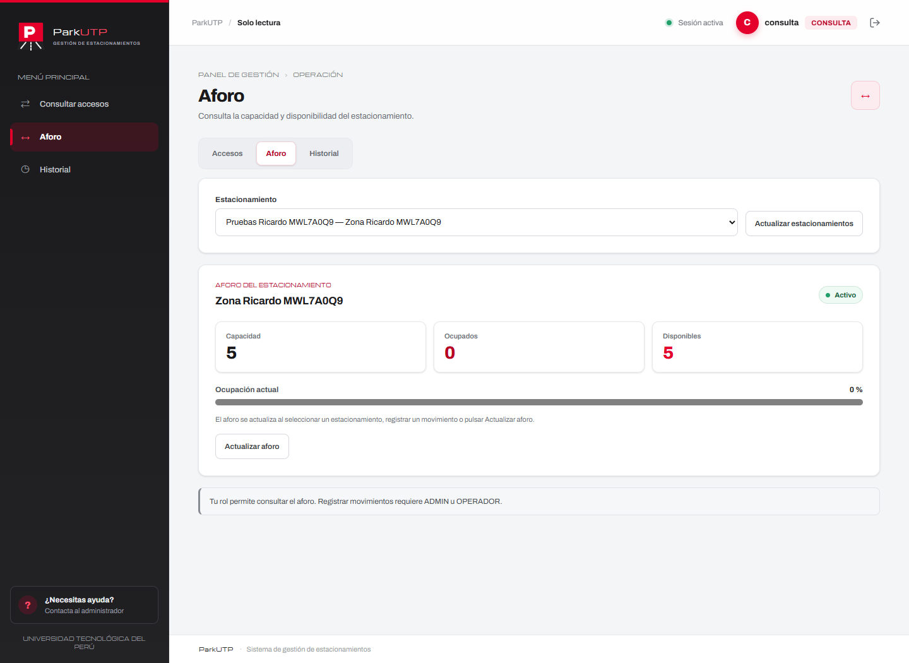

<div align="center">


# ParkUTP

### Gestión de estacionamientos universitarios

**Desarrollo Web Integrado · Avance 3**

Angular · Spring Boot · PostgreSQL

**Sergio · Melissa · Ricardo**

[Explorar las pantallas](#pantallas) · [Ejecutar el proyecto](#inicio-local) · [Revisar las pruebas](#pruebas-y-evidencias)

</div>

---

ParkUTP permite administrar sedes y estacionamientos, registrar ingresos y salidas y consultar el aforo y el historial desde una interfaz web con permisos por rol.

La aplicación conecta **Angular con una API REST de Spring Boot y PostgreSQL**. Los registros mostrados son datos de demostración: no representan capacidades ni movimientos institucionales reales.



*Registro de un ingreso desde Angular y actualización del aforo con la API real.*

## Contenido

- [Funciones y alcance](#funciones-y-alcance)
- [Pantallas](#pantallas)
- [Usuarios y permisos](#usuarios-y-permisos)
- [Arquitectura](#arquitectura)
- [Inicio local](#inicio-local)
- [Pruebas y evidencias](#pruebas-y-evidencias)
- [Recorrido para la demostración](#recorrido-para-la-demostración)
- [Solución de problemas](#solución-de-problemas)
- [Documentación y equipo](#documentación-y-equipo)

## Funciones y alcance

| Módulo | Funciones |
|:---|:---|
| **Sedes** | Crear, listar y editar sedes; confirmar la eliminación y mostrar restricciones por dependencias. |
| **Estacionamientos** | Administrar sede, nombre, capacidad y estado. El backend genera los accesos iniciales de entrada y salida. |
| **Accesos** | Crear, consultar, editar y eliminar accesos cuando las reglas de negocio lo permiten. |
| **Operación** | Registrar entradas y salidas, consultar ocupados y disponibles y actualizar el aforo. |
| **Historial** | Buscar movimientos por fecha de Perú, placa completa o parcial y tipo de movimiento. |
| **Autenticación** | Iniciar sesión con JWT, aplicar permisos y conservar la sesión al recargar la pestaña. |
| **Formularios** | Validar entradas, mostrar errores y avisar sobre cambios sin guardar en Sedes y Estacionamientos. |

El aforo se actualiza al seleccionar un estacionamiento, registrar un movimiento o solicitar una actualización. Los reintentos de movimientos utilizan un UUID para evitar duplicar la operación.

**Fuera del alcance actual:** reservas, cuentas de estudiantes, sensores y barreras físicas, recuperación de contraseñas y administración de usuarios.

## Pantallas

Las capturas siguientes pertenecen a los recorridos documentados contra la API real. Los nombres y cantidades corresponden a registros de prueba.

### Administración de estacionamientos



*Capacidad y estado editados desde Angular. El listado refleja la respuesta del backend.*

<details>
<summary><strong>Ver Sedes y protección de registros relacionados</strong></summary>



La API impide eliminar una sede que tiene estacionamientos asociados y la interfaz muestra el motivo.

</details>

<details>
<summary><strong>Ver gestión de accesos</strong></summary>



El administrador configura los accesos del estacionamiento. Los accesos utilizados por movimientos conservan su integridad referencial.

</details>

### Historial de movimientos



*Filtros combinados por fecha, placa y tipo de movimiento.*

<details>
<summary><strong>Ver la interfaz del rol CONSULTA</strong></summary>



La vista permite consultar aforo sin mostrar controles para registrar movimientos. El backend también comprueba los permisos.

</details>

## Usuarios y permisos

| Acción | ADMIN | OPERADOR | CONSULTA |
|:---|:---:|:---:|:---:|
| Administrar sedes y estacionamientos | Sí | No | No |
| Administrar accesos | Sí | No | No |
| Registrar ingresos y salidas | Sí | Sí | No |
| Consultar accesos, aforo e historial | Sí | Sí | Sí |

Las cuentas de demostración son `admin`, `operador` y `consulta`. La contraseña se configura localmente mediante `DEMO_PASSWORD` y no se publica en el repositorio.

La sesión se conserva en `sessionStorage`: **recargar la pestaña mantiene el acceso**. Cerrar sesión o recibir una respuesta 401 de la API elimina la sesión almacenada. La API valida el JWT y decide los permisos efectivos.

## Arquitectura

| Capa | Tecnología | Responsabilidad |
|:---|:---|:---|
| Interfaz | Angular 22, TypeScript y SCSS | Rutas, formularios, navegación por rol y consumo HTTP. |
| API | Java 21 y Spring Boot 3.2.5 | Reglas de negocio, validaciones y endpoints REST. |
| Seguridad | Spring Security y JWT | Autenticación y autorización. |
| Persistencia | JPA/Hibernate y PostgreSQL | Entidades, consultas y transacciones. |
| Entorno local | Docker Compose | Backend y base de datos con volumen persistente. |
| Pruebas de interfaz | Playwright | Recorridos con API simulada y real. |

```text
parkutp-proyweb/
├── frontend/                 Angular y recorridos Playwright
│   └── src/app/
│       ├── core/             Sesión, guard, interceptor y API
│       ├── layout/           Menú y estructura compartida
│       └── features/         Administración y operación
├── parkutp/                  Backend Spring Boot
│   ├── src/                  Código y pruebas Java
│   ├── scripts/              Inicio y configuración local
│   └── docs/                 Documentación técnica
├── docs/                     Guías y evidencias del equipo
├── compose.yaml              Servicios de Docker
└── README.md                 Guía principal del proyecto
```

Las vistas JSP/JSF del avance anterior se conservan en el backend. La interfaz principal del avance 3 es Angular.

## Inicio local

### Requisitos

- Git y Docker Desktop iniciado.
- Node.js compatible con Angular 22; el entorno local se verificó con Node 24.
- npm y Microsoft Edge para los recorridos de pruebas en Windows.
- Java 21 si se ejecuta el backend fuera de Docker.

### 1. Abrir el proyecto

En PowerShell, para la copia del Escritorio:

```powershell
cd "$env:USERPROFILE\Desktop\parkutp-proyweb"
```

Para una instalación nueva, clonar primero:

```powershell
cd "$env:USERPROFILE\Desktop"
git clone https://github.com/serchiove/parkutp-proyweb.git
cd parkutp-proyweb
```

### 2. Configurar las credenciales

Solo cuando todavía no exista `.env`:

```powershell
powershell -ExecutionPolicy Bypass -File parkutp/scripts/Configurar-Docker.ps1
```

El script solicita la contraseña demo y genera la configuración local. `.env` está excluido de Git.

| Variable | Uso |
|:---|:---|
| `WEB_PORT` | Puerto del backend; por defecto 8081. |
| `DB_PASSWORD` | Contraseña de PostgreSQL. |
| `JWT_SECRET` | Clave de firma de tokens. |
| `DEMO_PASSWORD` | Contraseña inicial de las cuentas de demostración. |
| `CORS_ORIGENES` | Origen permitido para Angular, normalmente `http://localhost:4200`. |

### 3. Iniciar backend y base de datos

```powershell
docker compose up -d --build
docker compose ps
```

### 4. Iniciar Angular

```powershell
cd frontend
npm.cmd ci
npm.cmd start
```

| Servicio | Dirección |
|:---|:---|
| **Aplicación Angular** | http://localhost:4200 |
| API REST | http://localhost:8081/api |
| Interfaz anterior | http://localhost:8081/login |

### 5. Detener el proyecto

En la terminal de Angular, presionar `Ctrl+C`. Desde la raíz del repositorio:

```powershell
docker compose stop
```

Los datos permanecen en el volumen de PostgreSQL.

## Pruebas y evidencias

### Resultados documentados

| Verificación | Resultado | Fecha |
|:---|:---|:---|
| Compilación Angular | Correcta, con advertencias de presupuesto CSS | 18/11/2026 |
| Administración y recarga de sesión, API simulada | 14 comprobaciones aprobadas | 18/11/2026 |
| Aviso de cambios sin guardar, API simulada | 4 comprobaciones aprobadas | 18/11/2026 |
| Accesos, operación, historial y roles, API simulada | 25 comprobaciones aprobadas | 18/11/2026 |
| Operación con API real y PostgreSQL | 14 comprobaciones aprobadas | 17/11/2026 |
| Administración con API real | Crear, editar, validar conflicto y eliminar registros propios: correcto | 17/11/2026 |
| JavaScript de la interfaz anterior | 10 pruebas aprobadas | 17/11/2026 |

**Las 43 comprobaciones simuladas verifican el frontend.** Los recorridos con API real comprueban la integración con Spring Boot y PostgreSQL. La suite Java y la persistencia después de reiniciar no se volvieron a ejecutar durante el último cierre.

### Ejecutar la verificación del frontend

Desde `frontend`:

```powershell
npm.cmd test
```

El comando compila y ejecuta los tres recorridos simulados. Playwright se instala con `npm ci`; Windows utiliza Edge. En otros entornos, configurar `PLAYWRIGHT_CHANNEL` o instalar Chromium mediante `npx playwright install chromium`.

Para compilar sin ejecutar los recorridos:

```powershell
npm.cmd run build
```

La salida se genera en `frontend/dist/frontend/browser`.

<details>
<summary><strong>Recorridos con API real</strong></summary>

Requieren backend activo y credenciales demo disponibles localmente. Utilizar un entorno destinado a revisión.

- `npm.cmd run test:api`: admite `DEMO_PASSWORD` en el entorno o en `.env`. Crea registros identificados con `RIC-` y conserva cuatro movimientos como evidencia.
- `npm.cmd run test:sedes:api`: requiere `MELISSA_DEMO_PASSWORD`. Crea y elimina exclusivamente sus registros.

Para ejecutar el segundo recorrido con el origen CORS habitual de Docker:

```powershell
$env:TEST_FRONTEND_HOST = 'localhost'
$env:TEST_FRONTEND_PORT = '4200'
npm.cmd run test:sedes:api
```

El puerto debe estar libre. Los recorridos actualizan capturas bajo `docs/`; revisar las diferencias antes de hacer commit.

</details>

<details>
<summary><strong>Advertencias conocidas del cierre</strong></summary>

- Algunos estilos superan el presupuesto de advertencia de 4 kB; la compilación termina correctamente.
- La auditoría del 17/11/2026 reportó alertas en dependencias de desarrollo relacionadas con `picomatch`. No ofrecía una corrección compatible para toda la cadena. No se aplicó una degradación forzada de Angular.
- La auditoría de dependencias de producción de esa fecha no reportó vulnerabilidades.

Detalles en [Cierre APF3](docs/CIERRE-APF3.md).

</details>

## Recorrido para la demostración

1. Iniciar sesión como ADMIN y presentar los permisos.
2. Crear una sede y un estacionamiento activo; revisar los accesos generados.
3. Mostrar una validación y el aviso al salir de un formulario sin guardar.
4. Registrar un ingreso y comprobar el aumento de ocupación.
5. Registrar la salida y buscar la placa en el historial.
6. Recargar la página y mostrar que la sesión permanece activa.
7. Cerrar sesión e ingresar como CONSULTA para mostrar las acciones disponibles.

## Solución de problemas

| Situación | Qué revisar |
|:---|:---|
| PowerShell bloquea `npm.ps1` | Usar `npm.cmd`, como en los ejemplos. |
| Angular no conecta con la API | Comprobar `docker compose ps`, el puerto 8081 y `CORS_ORIGENES`. |
| El login rechaza las credenciales | Usar la contraseña demo configurada en el entorno local. |
| La sesión vence | Iniciar sesión de nuevo; una recarga no renueva un JWT vencido. |
| Un registro no puede eliminarse | Leer el mensaje de la API: puede tener dependencias o historial asociado. |
| El puerto 4200 está ocupado | Detener el servidor Angular anterior antes de iniciar otro. |
| Se abre la interfaz antigua | Entrar a Angular en el puerto 4200. |

## Documentación y equipo

Este README es el punto de entrada del proyecto. Las guías técnicas y las evidencias detalladas se conservan como material de apoyo.

| Material | Enlace |
|:---|:---|
| Documentación histórica del avance 2 | [Guía APF2](docs/Guia-APF2.md) |
| Estado del cierre y límites de verificación | [Cierre APF3](docs/CIERRE-APF3.md) |
| Sedes y estacionamientos | [Guía de Melissa](docs/melissa/LEEME-MELISSA.md) |
| Accesos, operación e historial | [Guía de Ricardo](docs/ricardo/LEEME-RICARDO.md) |
| Imágenes de administración con API real | [Evidencias de Melissa](docs/melissa/evidencias/api-real/) |
| Resultados y capturas de operación | [Evidencias de Ricardo](docs/ricardo/evidencias/api-real/) |

**Equipo:** Sergio, Melissa y Ricardo. Proyecto académico de Desarrollo Web Integrado.
